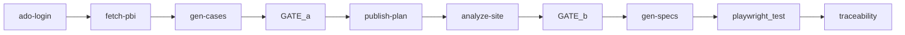

# AIAutomation (M1)

GitHub Copilot–driven **Playwright (TypeScript)** framework that connects **Azure DevOps** to a web app:

**Browser login (no PAT) → PBI → manual cases → [GATE a] → Test Plan → site analysis → [GATE b] → UI specs → run → traceability**

Full diagrams and asset map: **[docs/WORKFLOW.md](docs/WORKFLOW.md)**

---

## Workflow at a glance



---

## Quick start

```bash
cp .env.example .env
# Set: ADO_ORG, ADO_PROJECT, UI_BASE_URL, ALLOWED_BASE_URLS
npm install
npx playwright install chromium
npm run ai:ado-login          # browser Entra login — NO PAT
npm run ai:fetch-pbi -- 61
npm run ai:gen-cases          # then GATE (a)
```

### Required `.env`

| Variable | Purpose |
|----------|---------|
| `ADO_ORG` / `ADO_PROJECT` | Azure DevOps org & project |
| `ADO_AUTH_MODE` | `browser` (default) \| `device-code` \| `az-cli` |
| `ADO_PBI_ID` | Work item id (optional if passed on CLI) |
| `ADO_TEST_PLAN_ID` / `ADO_TEST_SUITE_ID` | Needed for `--apply` publish |
| `UI_BASE_URL` | App under test |
| `ALLOWED_BASE_URLS` | Comma-separated allowlist (required) |
| `ADO_PUBLISH_DRY_RUN` | `true` until you approve publish |

**Do not set `ADO_PAT`.** Auth is interactive browser login via `@azure/identity`.

---

## Copilot in VS Code

1. Copilot Chat → **Agent** mode  
2. Pick an agent from `.github/agents/` or use a slash prompt from `.github/prompts/`  
3. Repo rules: `.github/copilot-instructions.md`  
4. If skills do not auto-load, open `.github/skills/*/SKILL.md` or `prompt-library/` explicitly  

### Agents

| Agent | Responsibility |
|-------|----------------|
| `ado-reader` | Browser login + fetch compact PBI |
| `testcase-generator` | Design manual UI cases → GATE (a) |
| `site-analyzer` | Ask URL → Playwright CLI → page-model |
| `script-generator` | Generate specs → GATE (b); self-heal assist |
| `qa-orchestrator` | Full M1 sequence with gates |

### Prompts → agents

| Prompt | Agent |
|--------|-------|
| `/ado-login` | ado-reader |
| `/ado-fetch` | ado-reader |
| `/gen-cases` | testcase-generator |
| `/publish-plan` | qa-orchestrator |
| `/analyze-site` | site-analyzer |
| `/gen-specs` | script-generator |
| `/run-flow` | qa-orchestrator |

Prompt source of truth: [`prompt-library/INDEX.md`](prompt-library/INDEX.md)

---

## Commands

| Command | Purpose |
|---------|---------|
| `npm run ai:ado-login` | Entra browser login (no PAT) |
| `npm run ai:flow -- --pbi <id>` | Preflight + fetch; stops at GATE a |
| `npm run ai:fetch-pbi -- <id>` | Compact PBI → `artifacts/pbi/` |
| `npm run ai:gen-cases` | Scenarios + cases from PBI ACs (or Expected if AC empty) |
| `npm run ai:validate-cases` | Zod-validate scenarios/cases |
| `npm run ai:export-excel` | Excel: `artifacts/testcases/PBI-<id>-manual-tests.xlsx` |
| `npm run ai:publish-plan -- --dry-run` | Publish preview (default) |
| `npm run ai:publish-plan -- --apply` | Real publish after GATE (a) |
| `npm run ai:analyze-site -- <url>` | CLI snapshot + prune → page-model |
| `npm run ai:heal-context` | Failing step + error + 30-line trace |
| `npm run ai:traceability` | PBI → AC → Case → Spec matrix |
| `npm run ai:usage` | Token estimate summary |
| `npx playwright test` | Run tests — **no LLM** |

---

## Human gates

| Gate | Stop point | Resume when |
|------|------------|-------------|
| **(a)** | Cases written | You approve → dry-run then `--apply` |
| **(b)** | Before codegen | You approve files under `tests/generated/` |

---

## Safety & defaults

- URLs outside `ALLOWED_BASE_URLS` are refused  
- Production-like hosts blocked unless `APP_ENV=prod`  
- App login: `LOGIN_METHOD=none` by default; optional `npm run ai:save-auth`  
- Publish dry-run ON until `--apply`  
- Generated tests only in `tests/generated/`; hand edits in `tests/manual-edits/`  

Offline demo: `npm run ai:load-sample-pbi`

---

## Repo layout

```
.github/          copilot-instructions, agents, prompts, skills
prompt-library/   versioned prompts (source of truth)
src/ado/          browser auth + REST client + PBI/testplan
src/analyze/      snapshot prune + hash cache
src/ui/pages/     page objects (extend, don't regenerate)
scripts/          deterministic ai:* entrypoints
tests/generated/  AI specs only
tests/manual-edits/
artifacts/        pbi, testcases, snapshots, page-model, reports
docs/WORKFLOW.md  diagrams & detailed workflow
```

---

## Later milestones

- TODO M2: OpenAPI ingest, API specs, fixture-based hybrid tests, richer self-heal.  
- TODO M3: business/repo impact scoring, shared data graph.
