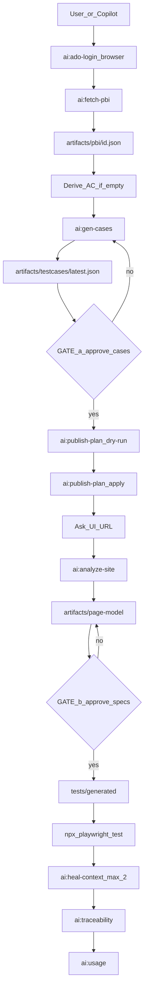
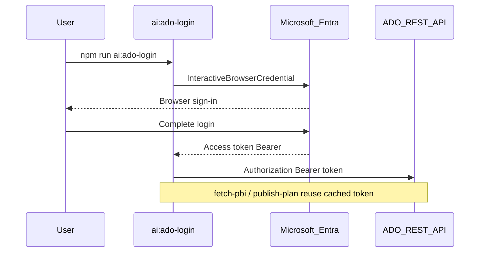
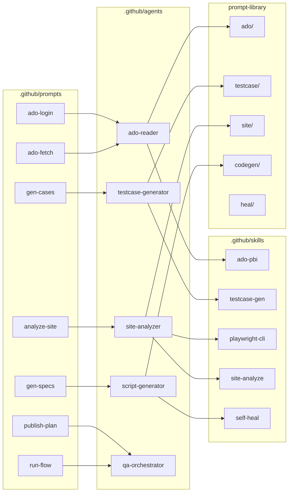
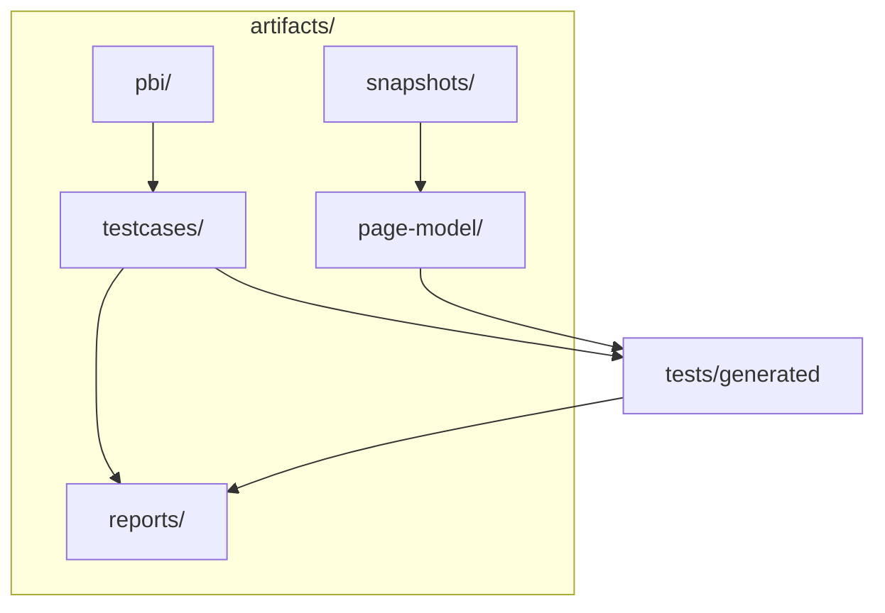

# M1 Workflow & Architecture

STLC agents (UC-01..UC-10): see [`STLC-AGENTS-CATALOG.md`](./STLC-AGENTS-CATALOG.md).

## End-to-end pipeline

## ADO browser auth (no PAT)

| Mode (`ADO_AUTH_MODE`) | Behavior |
|------------------------|----------|
| `browser` (default) | Opens system browser via `@azure/identity` |
| `device-code` | Prints code; user completes login in any browser |
| `az-cli` | Uses `az login` + `az account get-access-token` |

**Never use `ADO_PAT`.** On HTTP 401, agents re-run `npm run ai:ado-login`.

## Copilot asset map

| Prompt | Agent | Skill / library |
|--------|-------|-----------------|
| `/ado-login` | ado-reader | ado-pbi + `ai:ado-login` |
| `/ado-fetch` | ado-reader | ado-pbi → `ado/fetch-pbi.v1.md` |
| `/gen-cases` | testcase-generator | testcase-gen → `testcase/design-cases.v1.md` |
| `/publish-plan` | qa-orchestrator | `ado/publish-plan.v1.md` |
| `/analyze-site` | site-analyzer | playwright-cli, site-analyze |
| `/gen-specs` | script-generator | `codegen/playwright-ui-spec.v1.md` |
| `/run-flow` | qa-orchestrator | `testcase/run-flow.v1.md` |

## Artifacts

| Path | Producer | Consumer |
|------|----------|----------|
| `artifacts/pbi/{id}.json` | `ai:fetch-pbi` | case design |
| `artifacts/testcases/latest.json` | `ai:gen-cases` / Copilot | publish, codegen, traceability |
| `artifacts/snapshots/*.yml` | Playwright CLI | prune script only |
| `artifacts/page-model/*.json` | `ai:analyze-site` | script-generator |
| `artifacts/reports/publish-result.json` | `ai:publish-plan` | human review |
| `artifacts/reports/traceability.json` | `ai:traceability` | DoD evidence |
| `artifacts/usage.json` | all `ai:*` scripts | token savings check |

## Human gates

| Gate | When | Stop until |
|------|------|------------|
| **GATE (a)** | After `artifacts/testcases/latest.json` is ready | User approves cases before `--apply` publish |
| **GATE (b)** | After page-model, before writing specs | User approves planned files under `tests/generated/` |

## CI vs generation

| Phase | LLM? | Command |
|-------|------|---------|
| Explore / design / publish assist | Yes (Copilot) | agents + `ai:*` scripts |
| Test execution | **No** | `npx playwright test` |
| Self-heal assist | Yes (narrow) | `ai:heal-context` → max 2 safe fixes |

## Example: PBI 61

1. `npm run ai:ado-login`
2. `npm run ai:fetch-pbi -- 61`
3. If AC field empty → derive from **Expected** in description
4. `npm run ai:gen-cases` → GATE (a)
5. Dry-run publish → set `ADO_TEST_PLAN_ID` / `ADO_TEST_SUITE_ID` → `--apply`
6. `npm run ai:analyze-site -- <UI_BASE_URL>` → GATE (b) → specs → run

## Related docs

- [README.md](../README.md) — setup & commands  
- [copilot-instructions.md](../.github/copilot-instructions.md) — always-on Copilot rules  
- [prompt-library/INDEX.md](../prompt-library/INDEX.md) — prompt catalog  
